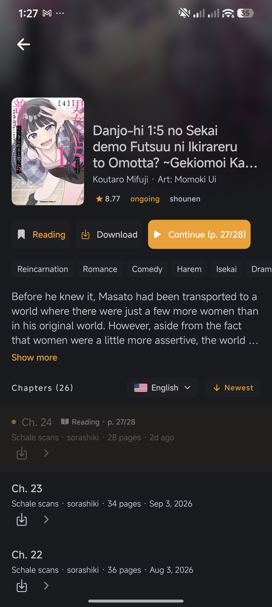
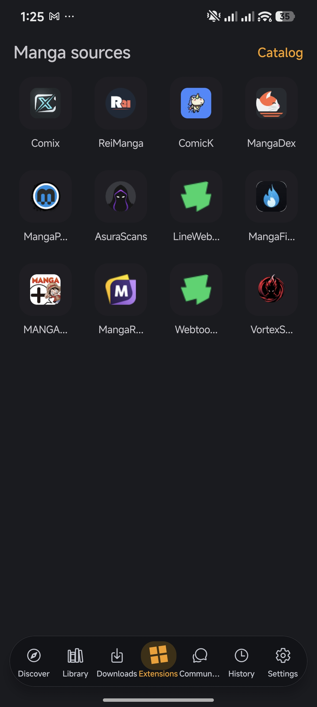
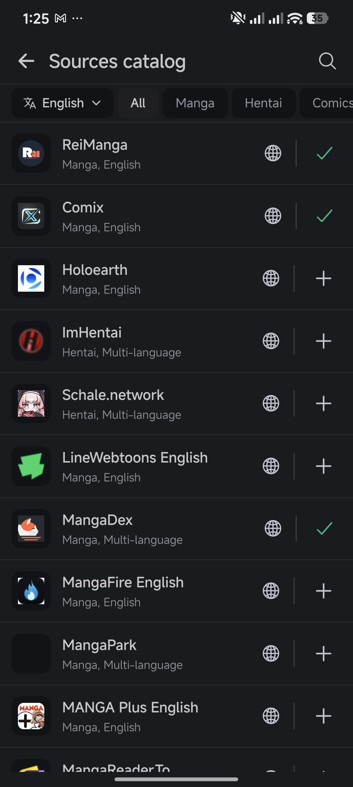
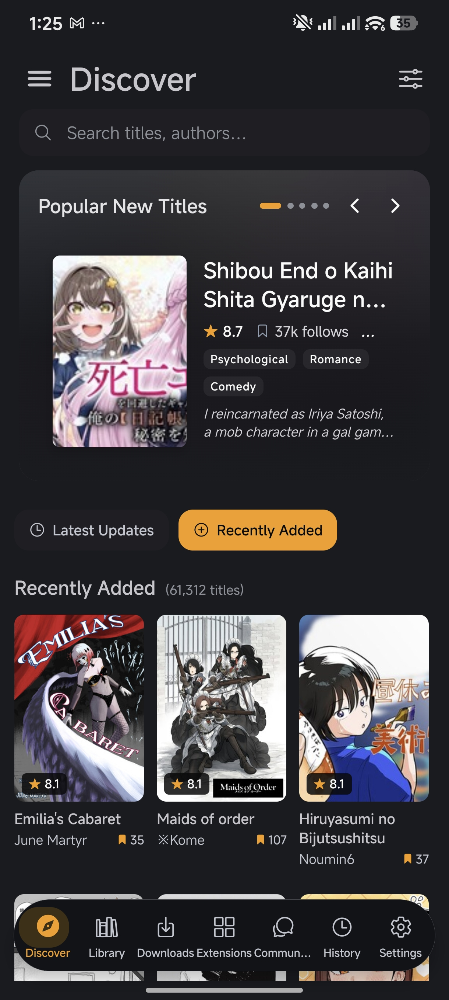
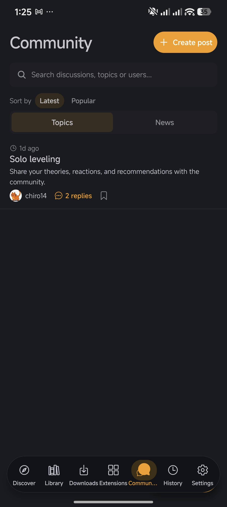
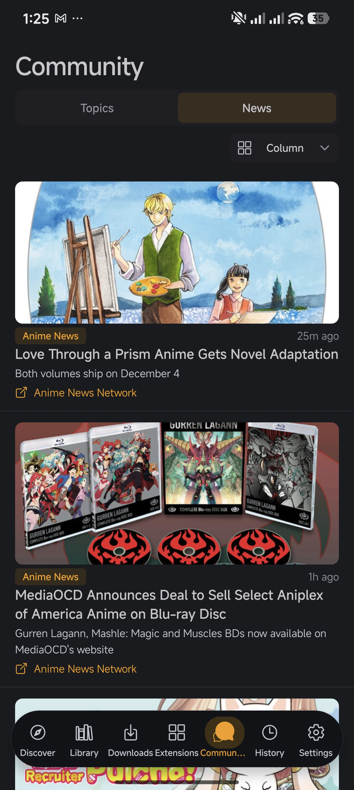
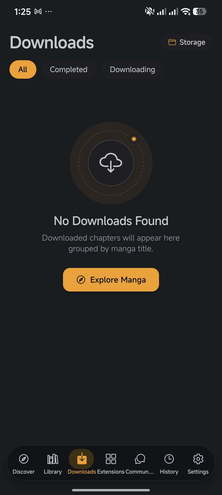
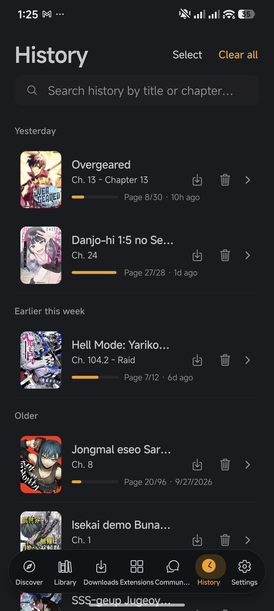
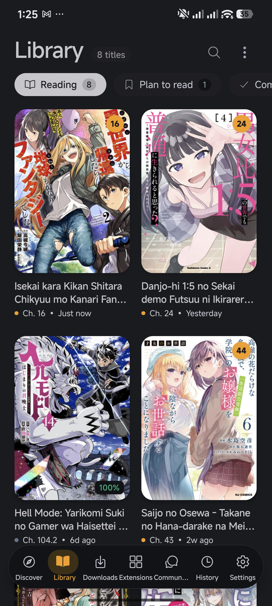
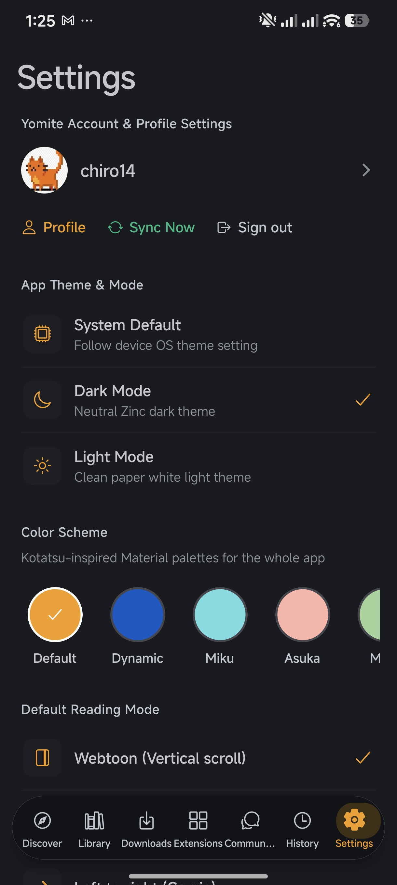

<div align="center">


# 📖 Yomite (読手)
### Modern, High-Performance Universal Manga Reader & Modular Extension Engine

[](https://expo.dev/)
[](https://reactnative.dev/)
[](https://react.dev/)
[](https://www.typescriptlang.org/)
[](https://supabase.com/)
[](LICENSE)

<p align="center">
  <b>Yomite</b> is an open-source, ultra-fast manga and comic reader engineered with <b>Expo SDK 57</b>, <b>React 19</b>, and <b>Expo Router</b>. Designed with a distraction-free <b>Pure Canvas</b> reading engine, a resilient <b>Modular Parser Architecture</b> for endless manga sources, offline chapter caching, and seamless cross-platform synchronization across Android, Web, and iOS.
</p>

<p align="center">
  <a href="#-quick-install--preview"><b>📲 Install Android Build</b></a> •
  <a href="#-visual-showcase--gallery"><b>📸 Screenshots</b></a> •
  <a href="#-features"><b>✨ Features</b></a> •
  <a href="#-supported-sources-catalog"><b>🌐 Source Parsers</b></a> •
  <a href="#-getting-started"><b>🚀 Quick Start</b></a> •
  <a href="#-project-architecture"><b>📂 Architecture</b></a>
</p>

---

</div>

## 📲 Quick Install & Preview

Experience Yomite directly on your Android device via Expo Application Services (EAS):

<div align="center">

| 📲 Direct APK Download | 📷 Scan to Install |
| :---: | :---: |
| <br />[](https://expo.dev/accounts/chiro14/projects/yomite/builds/9426d93f-0d4b-43dc-bd96-91f51a33ff77)<br /><br />**[Direct Expo EAS Build Link](https://expo.dev/accounts/chiro14/projects/yomite/builds/9426d93f-0d4b-43dc-bd96-91f51a33ff77)** | <br />*Scan with phone camera to download* |

</div>

---

## 📸 Visual Showcase & Gallery

### 1. 📖 The Pure Canvas Reading Experience
Distraction-free reading with zero bloat, full keyboard controls, and multi-format panel navigation.

| 📖 Pure Canvas Reader Engine | 📑 Manga Details & Chapter Selector |
| :---: | :---: |
|  |  |
| *Continuous Webtoon, Single & Double Page spreads* | *Multi-source selector, chapter sorting & read tracking* |

<br />

### 2. 🧩 Modular Extension Engine *(Recent Feature)*
Dynamic source management with Cloudflare resilience, multi-language filtering, and direct scraping parsers.

| 🧩 Source Extensions Manager | 📚 Boundless Source Catalog |
| :---: | :---: |
|  |  |
| *One-tap install/toggle with country flag badges* | *Explore multi-language manga indexes & catalogs* |

<br />

### 3. 🔍 Discovery Spotlight & Community
Personalized recommendation spotlight carousels, active community topic boards, and syndicated anime news.

| 🌟 Discover Spotlight Carousel | 💬 Reader Community Topics | 📰 Anime News & Updates |
| :---: | :---: | :---: |
|  |  |  |
| *Dynamic blur backdrop & trending manga* | *Chapter reviews & reader discussions* | *Aggregated anime & manga industry headlines* |

<br />

### 4. 📥 Offline Vault & Personal Tracking
Read anywhere with background chapter downloading, local storage persistence, and profile streaks.

| 📥 Offline Downloads Vault | 🕒 Reading Timeline & History | 📚 Cloud Library Collections | ⚙️ App Appearance & Settings |
| :---: | :---: | :---: | :---: |
|  |  |  |  |
| *Zero-login background downloads* | *Exact chapter progress tracker* | *Custom categories & status tags* | *OLED themes & reader controls* |

---

## ✨ Features

### 🧩 1. Resilient Modular Source Engine *(New)*
- **Pluggable Architecture**: Extensible parser model implementing `BaseParser`, `SourceManager`, and `HttpParser` for plug-and-play scrapers.
- **Network Resilience & Cloudflare Handling**: Built-in User-Agent rotation, dynamic cookie preservation, custom referer spoofing, and automatic retry algorithms.
- **Language Filtering**: Multi-language support with automatic country flags via `flagcdn.com` (English, Japanese, Spanish, French, Korean, Portuguese, and more).
- **Extension Management**: Install, uninstall, enable, and switch sources on the fly directly inside the app.

### 📖 2. High-Performance Reading Engine
- **Multiple Reading Modes**:
  - 📜 **Webtoon / Long Strip**: Continuous fluid vertical scrolling with virtualized infinite panel loading.
  - 📄 **Single Page**: Distraction-free page-by-page viewing with tap/swipe transitions.
  - 📑 **Double Page**: Desktop and tablet spread simulation for authentic two-page manga spreads.
  - 🔁 **Direction Switching**: Left-to-Right (Western / Manhwa) and Right-to-Left (Traditional Japanese Manga).
- **Desktop Keyboard Shortcuts**:
  - `←` / `→` page flip, `Space` scroll, `F` fullscreen toggle, `M` chapter drawer, `Esc` close overlays.
- **Reading Comfort**:
  - Customizable reader themes: **OLED Deep Black**, **Dark Charcoal**, **Sepia Warm**, and **Pure White**.
  - Custom image fitting: Fit Width, Fit Height, Original Scale.

### 📥 3. Offline Chapter Downloads & Local Cache
- **Zero-Login Full Offline Support**: All library bookmarks, reading history, and downloaded chapters work with 100% offline persistence using `AsyncStorage`.
- **Parallel Chapter Downloader**: Queue entire chapters to local storage with real-time download progress tracking.
- **Network Resilience**: Automatic offline detection (`NetInfo`) with intelligent pulse indicator prompting users to access offline downloads.

### 📚 4. Cloud Library & Reading History
- **Smart Categorization**: Organize your collection into *Reading*, *Plan to Read*, *Completed*, *On Hold*, *Dropped*, and *Favorites*.
- **Cross-Device Synchronization**: Optional Supabase cloud account sync for your library, reading bookmarks, and history across Web, Android, and iOS.
- **Import / Export**: Backup and restore your reading list and custom categories in JSON format.

### 💬 5. Community & News Feed
- **Reader Discussions**: Discuss chapters, share recommendations, and leave reviews powered by Supabase PostgreSQL.
- **Anime News Aggregator**: Real-time syndicated anime and manga industry articles, release schedules, and video embeds.
- **Visual Quote Share Cards**: Generate branded manga recommendation cards with cover art, summary, and QR code (`react-native-view-shot`).

### 🎨 6. Apple-Grade Aesthetics & Design Engineering
- **Obsidian Dark & Glassmorphism**: Tailored HSL color palette with frosted glass navigation bars (`expo-blur`).
- **Spring Physics & Micro-Interactions**: Tactile button scaling (`scale(0.97)`), 60fps spring transitions (`AnimatedPressable`), and haptic feedback (`expo-haptics`).

---

## 🌐 Supported Sources Catalog

Yomite features a unified source provider catalog with native parsers and scrapers:

| Source | Language | Protocol | Type | Status |
| :--- | :---: | :---: | :---: | :---: |
| **MangaDex** | Multi (EN, JA, ES, FR, etc.) | REST API v5 | Official Catalog | 🟢 Active |
| **AsuraScans** | English | HTML / Scraper | Popular Manhwa | 🟢 Active |
| **Comick** | Multi | REST / JSON | High-Res Comics | 🟢 Active |
| **ComixTo** | English | HTML / Scraper | Fast Mirrors | 🟢 Active |
| **HeanCms** | English / Spanish | REST / CMS | Webtoon Studio | 🟢 Active |
| **Hitomi.la** | Multi | Scraper & Token Engine | Direct Media | 🟢 Active |
| **Iken** | English | HTML / Scraper | Scanlations | 🟢 Active |
| **NHentai** | Multi | Media Scraper | Archival Media | 🟢 Active |
| **ReiManga** | Spanish / English | Scraper & Chunk Parser | Manga & Manhwa | 🟢 Active |

---

## 🛠️ Technology Stack

| Domain | Technology | Description |
| :--- | :--- | :--- |
| **Core Framework** | [Expo SDK 57](https://expo.dev/) | Modern universal React Native application platform |
| **Routing System** | [Expo Router v4](https://docs.expo.dev/router/introduction/) | Typed, file-based routing architecture |
| **UI Framework** | [React Native 0.86](https://reactnative.dev/) | React 19.2 + React Native Web 0.21 |
| **Language** | [TypeScript 5.0+](https://www.typescriptlang.org/) | Strict type safety across parsers, stores, and UI |
| **State Management** | [Zustand](https://github.com/pmndrs/zustand) | Lightweight, persistent atomic stores (`AsyncStorage`) |
| **Backend & Cloud** | [Supabase](https://supabase.com/) | PostgreSQL, Row Level Security, Auth (OAuth + Email) |
| **HTML Scraping** | [Cheerio](https://cheerio.js.org/) / Regex | Fast server-side and client-side DOM parsing |
| **Image Pipeline** | [Expo Image](https://docs.expo.dev/versions/latest/sdk/image/) | Hardware-accelerated image decoding with blurhash |
| **Haptics & Motion** | `expo-haptics` & Reanimated | Tactile vibration feedback and 60fps physics animations |

---

## 📂 Project Architecture

```text
Yomite/
├── app/                        # Expo Router file-based pages & layouts
│   ├── (tabs)/                 # Main bottom tab navigator
│   │   ├── index.tsx           # Discover & spotlight hero screen
│   │   ├── extensions.tsx      # Source extensions manager & catalog
│   │   ├── library.tsx         # User library collections & categories
│   │   ├── history.tsx         # Reading timeline & resume tracker
│   │   ├── community.tsx       # Social discussion boards & anime news
│   │   ├── settings.tsx        # App appearance, OLED themes & storage
│   │   └── _layout.tsx         # Floating glassmorphic tab bar layout
│   ├── manga/
│   │   └── [id].tsx            # Manga detail page, chapter list & source switcher
│   ├── reader/
│   │   └── [chapterId].tsx     # Pure Canvas reader engine (Webtoon, Spread, Single)
│   ├── profile.tsx             # User profile, statistics & streaks
│   ├── download.tsx            # Standalone landing & download page
│   └── _layout.tsx             # Root layout with theme & auth providers
├── src/
│   ├── api/                    # External API integrations (MangaDex, Supabase)
│   │   ├── mangadex.ts         # MangaDex REST API client with Axios interceptors
│   │   └── supabase.ts         # Supabase client initialization & auth helper
│   ├── sources/                # Modular Source Parser Engine
│   │   ├── SourceManager.ts    # Central registry for installing/executing parsers
│   │   ├── types.ts            # Standardized manga, chapter, and page interfaces
│   │   ├── adapter.ts          # Unified adapter bridging MangaDex and custom scrapers
│   │   ├── network/            # Resilient HTTP & Cloudflare bypass clients
│   │   │   ├── httpClient.ts   # Axios wrapper with header rotation & retry logic
│   │   │   ├── cloudflare.ts   # Anti-bot and cookie preservation utilities
│   │   │   └── htmlParser.ts   # Lightweight DOM query helpers
│   │   └── parsers/            # Individual source parsers
│   │       ├── BaseParser.ts   # Abstract parser base class
│   │       ├── AsuraScansParser.ts
│   │       ├── ComickParser.ts
│   │       ├── ComixToParser.ts
│   │       ├── HeanCmsParser.ts
│   │       ├── HitomiLaParser.ts
│   │       ├── IkenParser.ts
│   │       ├── MangaDexParser.ts
│   │       ├── NHentaiParser.ts
│   │       └── ReiMangaParser.ts
│   ├── components/             # Reusable UI component library
│   │   ├── AnimatedCard.tsx    # Staggered entrance cards with touch scaling
│   │   ├── AnimatedPressable.tsx # Micro-interaction buttons with haptic feedback
│   │   ├── AdvancedSearchModal.tsx # Filter matrix & tag search dialog
│   │   ├── MangaCard.tsx       # Manga card with cover image & rating badges
│   │   ├── ReaderMenuDrawer.tsx# Reader settings & chapter jump slide-over
│   │   └── Skeleton.tsx        # Shimmer skeleton loader placeholders
│   ├── stores/                 # Zustand global application state
│   │   ├── authStore.ts        # User sessions & profile data
│   │   ├── bookmarkStore.ts    # Library collections & chapter sync
│   │   ├── downloadStore.ts    # Offline chapter queue & storage manager
│   │   ├── historyStore.ts     # Chapter progress & last-read tracker
│   │   ├── readerStore.ts      # Reading mode, zoom, fit & direction configs
│   │   └── settingsStore.ts    # Accent colors, NSFW toggles & cache limits
│   └── utils/                  # Utility helpers
│       ├── haptics.ts          # Safe haptic feedback triggers
│       ├── language.ts         # MangaDex language codes & flagcdn helpers
│       └── storage.ts          # Cross-platform persistent storage adapter
├── assets/
│   ├── screenshots/            # Showcase screenshots & scan QR codes
│   └── images/                 # App icons, splash screens & brand assets
├── app.json                    # Expo project configuration
└── package.json                # Dependencies and build scripts
```

---

## 🚀 Getting Started

### Prerequisites
- **Node.js**: `v18.0.0` or higher (LTS recommended)
- **npm** or **bun** / **yarn** / **pnpm**
- **Expo Go App** (optional, for running on physical mobile devices)

### Installation

1. **Clone the repository**:
   ```bash
   git clone https://github.com/jlfuertes14/Yomite.git
   cd Yomite
   ```

2. **Install dependencies**:
   ```bash
   npm install
   ```

3. **Configure Environment Variables**:
   Create a `.env` file in the root directory:
   ```env
   EXPO_PUBLIC_SUPABASE_URL=https://your-project.supabase.co
   EXPO_PUBLIC_SUPABASE_ANON_KEY=your-anon-key-here
   ```
   *(Note: Supabase is optional! Yomite works seamlessly in 100% offline guest mode without any cloud credentials).*

4. **Initialize Supabase Database (Optional for Cloud Sync)**:
   - Run the SQL script found in [`supabase_schema.sql`](supabase_schema.sql) in your Supabase SQL Editor.

---

## 💻 Running the App

### Start Development Server
```bash
npx expo start
```

### Launch by Platform
```bash
# Launch Desktop Web in your browser
npm run web

# Launch in Android Emulator or USB Connected Device
npm run android

# Launch in iOS Simulator (macOS only)
npm run ios
```

---

## 📦 Building Standalone Binaries

### Android (APK & Google Play AAB) via Expo Application Services (EAS)
```bash
# Install EAS CLI globally
npm install -g eas-cli

# Log in to your Expo account
eas login

# Build preview APK (standalone installable file)
eas build -p android --profile preview

# Build production Android App Bundle (AAB) for Google Play
eas build -p android --profile production
```

### Web Production Export
```bash
# Export static web bundle to dist/
npx expo export --platform web

# Deploy to Vercel
npx vercel deploy --prod
```

---

## ⌨️ Desktop Keyboard Shortcuts

| Shortcut | Action |
| :---: | :--- |
| `→` / `D` | Next Page / Next Chapter |
| `←` / `A` | Previous Page / Previous Chapter |
| `Space` | Scroll Down (Webtoon mode) |
| `F` | Toggle Fullscreen |
| `M` | Open Reader Menu & Chapter Jump |
| `Esc` | Close Reader Drawer / Exit Modals |
| `Ctrl + K` / `Cmd + K` | Open Spotlight Search Modal |

---

## 🤝 Contributing

Contributions, source parser additions, and feature requests are warmly welcomed!

1. Fork the Project (`https://github.com/jlfuertes14/Yomite/fork`)
2. Create your Feature Branch (`git checkout -b feature/NewMangaSource`)
3. Commit your Changes (`git commit -m 'feat(parsers): add NewMangaSource parser'`)
4. Push to the Branch (`git push origin feature/NewMangaSource`)
5. Open a Pull Request

---

## 📄 License

Distributed under the **MIT License**. See [`LICENSE`](LICENSE) for more details.

---

<div align="center">
  <sub>Crafted with ❤️ by <a href="https://github.com/jlfuertes14">jlfuertes14</a> & the Yomite Community.</sub>
</div>
